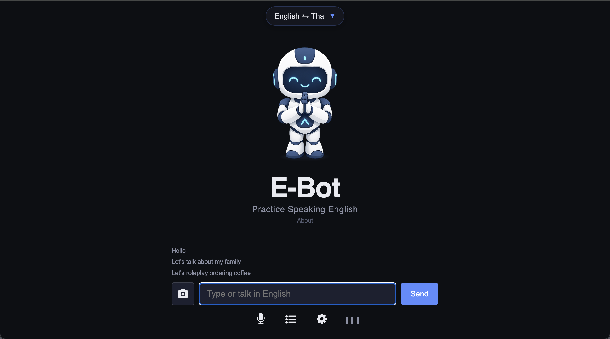
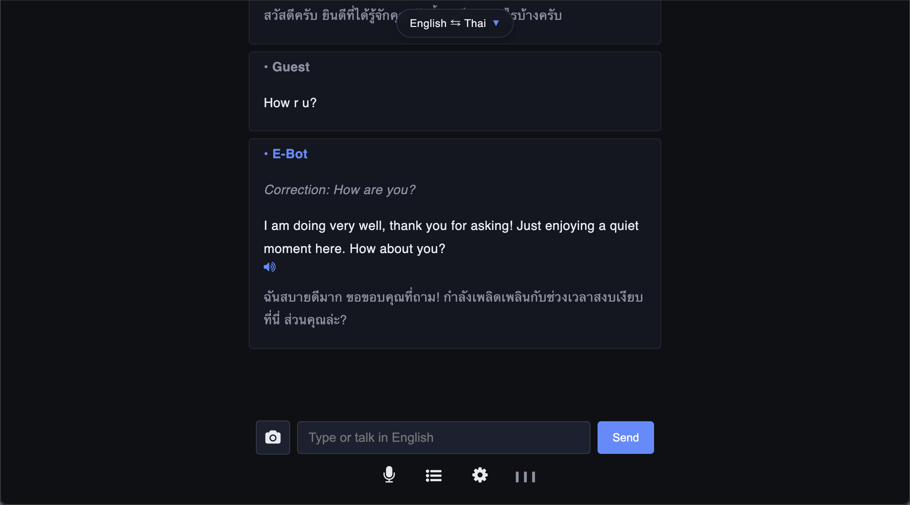
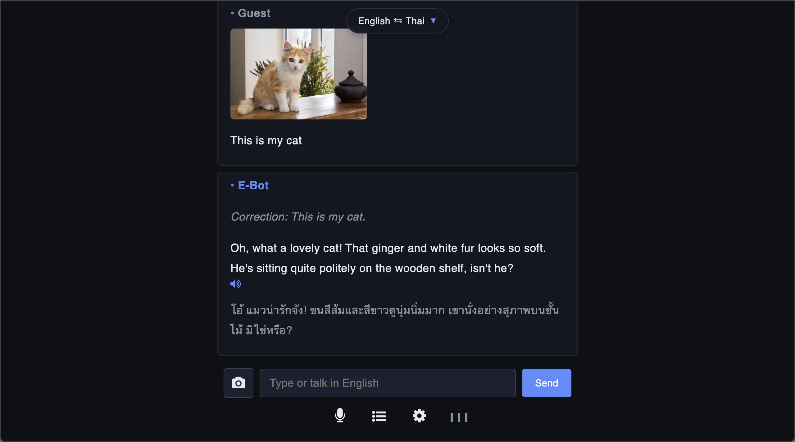
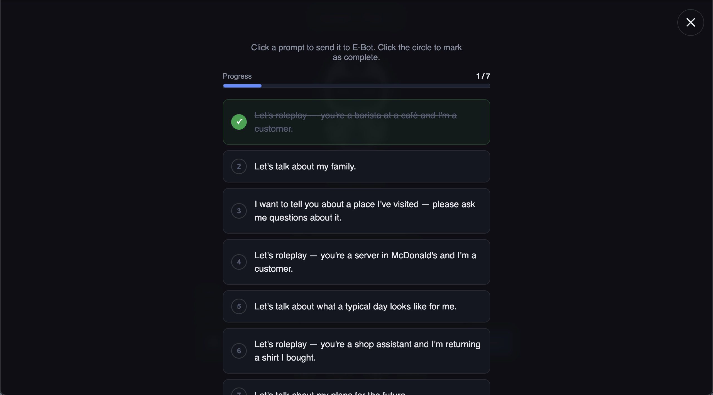

# E-Bot English Practice Chatbot - 2026

Live Demo - 2026 version: 
  
https://ebot2026.woza.work/

E-Bot is a chatbot for practicing spoken English. There's no fixed course or lesson plan. You just talk naturally and E-Bot responds with both text and voice.

Many learners know English grammar, but find it hard to get real-world conversation practice. Also, many are shy or anxious about making mistakes in front of others.

E-Bot tries to solve these problems by providing a patient, private and low-stress way to practice English conversation on a phone or on a desktop computer.

E-bot is powered by the Qwen3.5-Flash model served via OpenRouter. This is a fast and powerful AI model that currently costs a fraction of a cent per request (https://openrouter.ai/qwen/qwen3.5-flash-02-23). Also, instead of using paid speech-to-text (STT) and text-to-speech (TTS) services, this solution uses Javascript SpeechRecognition and Javascript SpeechSynthesis. Both are built into the browser and are free. One downside is that voice quality can sometimes sound robotic - depends on the browser and on the operating system being used. 

This is a zero friction solution - nothing to download, no registration, no login, no rate limits, no marketing landing page. The user just goes to the website and starts talking.

 

> The E-Bot workflow can be easily modified to help users practice other languages besides English. In fact, because the API costs are low, I think this could be a good classroom project for international schools - combining coding, AI and social impact. 

 
 

Dark mode

 

Correction and translation

 

Supports images

 

Ready-made exercises

 

## Quick Info
- Mobile optimized web app
- Supports both voice and text
- Supports images e.g. upload a photo of a menu and roleplay ordering from it.
- Translates English responses into the user's native language. Supports 86 languages.
- Corrects the user's spelling and grammar errors without disturbing the conversation flow.
- Click any response to replay the audio
- Minimalist UI design with light and dark modes
- Frontend: Html, CSS, Javascript
- Backend: PHP
- Uses the OpenRouter API (qwen3.5-flash-02-23 and qwen/qwen3.7-flash - by Alibaba)
- Set up as a three-agent LLM system - chat, correction, translation
- Uses Javascript SpeechRecognition to convert the user's speech into text
- Uses Javascript SpeechSynthesis to convert text to speech
- Has visual audio cues for deaf learners
- Can be rebranded and self-hosted on any shared hosting platform
- For the best voice quality, the Chrome desktop browser should be used because the latest version now has built in high quality TTS voices. The voice quality on Android mobile devices is also good.

  

## Deployment Notes

- Add your OpenRouter API key to the ebot_config.ini.txt file before uploading to your web host server.
- Change the name of the file from ebot_config.ini.txt to ebot_config.ini
- For added security it's best to locate the ebot_config.ini file outside the web host root folder.

 

## Notes
- This solution needs to be validated. The pain point exists, but does this approach effectively solve it for users who are highly motivated English learners?
- This app needs to be beta tested by non-english speakers under real world conditions e.g. using their own mobile devices.
- Need to test how well the STT system handles accented English and non-standard English pronounciations e.g. mo-char versus mo-car (coffee)
- The API cost needs to be monitored.
- The voice quality on mobile (Android) is much better than that on desktop.
- The voice type and gender will vary across devices and across operating systems. This will be an issue with languages that have gender specific ways of speaking e.g. Thai.
- The app is non-profit with no ads, but it depends on a paid third-party AI model. Therefore, it's not clear how API costs and hosting costs will be covered as usage grows.
- The current design is focused on serving motivated, self-directed learners. There's no lesson plan, no gamification, no streaks, and no external prompts to come back. This fact needs to be borne in mind when selecting beta testers - unless there are technical problems, just because someone loses interest in the app doesn't mean it's bad. It could mean that that person is just not who this app was built for.
- Tested the app using the Brave browser on Andriod. It works well. There's no frustrating bloat and clutter like there is on more main stream browsers.
- The API key can be easily stolen if the ebot_config.ini file is located inside the website root folder therefore, always locate this file outside the website root folder.
- The latest version of the Chrome desktop browser includes built in high quality TTS voices e.g. Google US English. Therefore, Google Chrome will provide the best user experience. Previously high quality built in voice was only available on Android.
 

## Revision History

Version 3.5 
12-October-2026 
- Added a translation feature. This will help users quickly check how to say things in English without affecting the flow of the conversation.
- Made "Google UK English Female" the default voice.
- In the proofreader_agent and the translation_agent changed the model to qwen/qwen3.7-flash. This cheaper model will reduce API costs. The chat_agent still uses qwen3.5-flash-02-23 because it's better at chatting.

Version 3.4 
11-October-2026 
- Made Google US English the default voice. This will improve the user experience for those using the Chrome desktop browser.

Version 3.3 
3-October-2026 
- Fixed issue where language selector was not working in Safari.

Version 3.2 
13-August-2026 
- Added a list of commonly used languages to the language search.
- Added the ability to save the user's selected language.
- Edited the About page subtitle.

Version 3.1 
5-August-2026 
- Made light-mode the default theme.

Version 3.0 
28-July-2026 
Released for beta testing.

 
